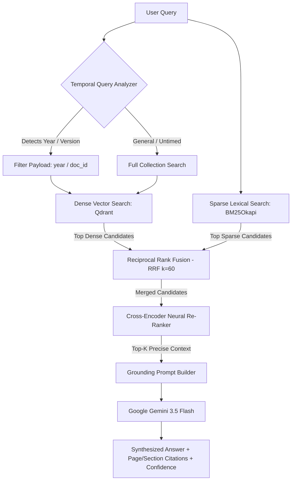

# DocuSense AI 📄⚡

> **Context-Aware Enterprise Document Intelligence Powered by Hybrid RAG, Temporal Analytics & Google Gemini**

<div align="center">

[](https://fastapi.tiangolo.com/)
[](https://www.python.org/)
[](https://qdrant.tech/)
[](https://aistudio.google.com/)
[](https://www.postgresql.org/)
[](https://render.com)
[](LICENSE)

**[🌐 Live Production Web App](https://docusense-backend-r138.onrender.com/)** • **[📖 Interactive API Docs (Swagger)](https://docusense-backend-r138.onrender.com/docs)** • **[📑 Deployment Guide](RENDER_DEPLOYMENT.md)**

</div>

---

## 📑 Table of Contents

- [Overview](#-overview)
- [Key Features](#-key-features)
- [UI & Interactive Experience](#-ui--interactive-experience)
- [System Architecture](#-system-architecture)
- [Hybrid Retrieval Pipeline](#-hybrid-retrieval-pipeline)
- [Technology Stack](#-technology-stack)
- [Quickstart: Local Development](#-quickstart-local-development)
- [Docker Deployment](#-docker-deployment-local-containerized)
- [Cloud Deployment (Render + Qdrant Cloud + Google OAuth)](#-cloud-deployment-render--qdrant-cloud--google-oauth)
- [Environment Configuration](#-environment-configuration-reference)
- [REST API Reference](#-rest-api-reference)
- [Testing & Quality Assurance](#-testing--quality-assurance)
- [Security & Production Hardening](#-security--production-hardening)
- [License](#-license)

---

## 🌟 Overview

**DocuSense** is a high-assurance enterprise document intelligence platform engineered to eliminate corporate hallucinations, bridge policy version gaps, and make institutional documentation verifiable down to the page and section.

Traditional semantic search often misses exact numerical codes, employee tier identifiers, or subtle clause revisions. DocuSense solves this by orchestrating a **multi-stage hybrid retrieval architecture**:
1. **Dense Semantic Embeddings** via Qdrant Cloud (384-dimensional cosine index).
2. **Sparse Lexical Search** using BM25Okapi for exact policy clause numbers and tokens.
3. **Reciprocal Rank Fusion (RRF)** to combine dense and sparse rankings objectively.
4. **Cross-Encoder Re-ranking** to evaluate deep query-passage semantic relevance.
5. **Grounded Synthesis** via **Google Gemini 3.5 Flash** with strict source citations and confidence metrics.

---

## 🚀 Key Features

### 1. 🧠 Dual-Brain Grounded Chat
- **Document Evidence Mode**: Questions regarding policies, clauses, or uploaded files trigger deep retrieval. Answers include interactive citation badges detailing source document, version, page number, and section title.
- **Conversational General Mode**: Open reasoning queries (e.g. general explanations, Python coding questions, greetings, math) are answered gracefully without false refusals or hallucinating fake document policies.
- **Confidence Scoring & Support**: Real-time evaluation of evidence strength (e.g. `96% Verified Support`) displayed alongside LLM responses.
- **Persistent Chat History**: Session persistence with renaming, deleting, and auto-title generation stored in PostgreSQL with timezone-aware timestamps.

### 2. 📑 Universal Document Hub & Ingestion Engine
- **Multi-Format Ingestion**: Ingests `.pdf`, `.docx`, and `.txt` files with automated text sanitization and structure preservation.
- **Hierarchical Section Chunking**: Intelligently segments documents by section headers, keeping page-level offsets and table metadata intact.
- **Instant Demo Policy Loader**: One-click initialization of comparative enterprise policies (`HR_Policy_2024.txt` and `HR_Policy_2026.txt`) to test version changes immediately.
- **Full-Text Document Viewer**: In-app document inspection drawer displaying raw page text, structured chunks, and vector embedding identifiers.

### 3. ⚡ Multi-Stage Hybrid Retrieval (RRF + Rerank)
- **Dense Vector Search**: Powered by Qdrant Cloud (cosine distance) for conceptual semantics.
- **Sparse BM25 Search**: Exact keyword and token indexing for alphanumeric policy codes (e.g., `POL-2026-X`).
- **Reciprocal Rank Fusion (RRF)**: Merges rankings with $RRF\_Score = \sum \frac{1}{k + rank}$ ($k=60$) to neutralize score variance between algorithms.
- **Cross-Encoder Neural Reranking**: Re-evaluates top-$N$ fused candidates to produce high-precision contextual ordering before prompt injection.
- **Configurable Search Modes**: Supports `mode=dense`, `mode=sparse`, and `mode=hybrid` through the `/api/v1/search` endpoint.

### 4. ⏳ Temporal Intelligence & Version Awareness
- **Temporal Query Parsing**: Automatically identifies target calendar years and policy terms from queries (e.g., *"What was the parental leave in 2024 vs 2026?"*).
- **Metadata Pre-Filtering**: Restricts or prioritizes search chunks matching the target policy lifecycle.
- **Acronym Expansion**: Normalizes institutional abbreviations without corrupting source fidelity.

### 5. 🔍 Clause Diff Matrix & Contradiction Detection
- **Side-by-Side Clause Diff**: Visual side-by-side alignment of baseline and updated documents with color-coded status badges (`added`, `modified`, `removed`).
- **Automated Conflict Detector**: Highlights numerical discrepancies, allowance changes (e.g., shifts from 2 to 3 remote work days or gym stipend adjustments), and rule modifications.
- **Evolutionary Audit Timeline**: Tracks how institutional policies change across regulatory revisions.

### 6. 🔐 Enterprise Authentication & Production Security
- **Google OAuth 2.0**: Seamless single-sign-on (SSO) with automated redirect resolution for both local development and production reverse proxies.
- **Secure Encrypted Sessions**: Session management using signed, HTTP-only cookies (`SessionMiddleware` + `itsdangerous`).
- **Strict Foreign Key Isolation**: Timezone-aware UTC models and relational foreign-key validation prevent orphaned vector points.

---

## 🎨 UI & Interactive Experience

DocuSense features a zero-dependency, handcrafted Vanilla JS/CSS single-page application built with modern design principles:
- **Glassmorphism Design System**: Tailored dark theme with subtle gradients, frosted glass backdrops, and HSL tokens.
- **Slide-Over Citation Drawer**: Clicking any citation chip (`[Doc: HR_Policy_2026, P.2]`) slides open an inspector drawer highlighting the exact source passage.
- **Live Telemetry & Analytics**: Visual counters tracking total indexed documents, vector chunks, average retrieval latency, and model statuses.
- **Responsive Navigation**: Adaptive layouts optimized for desktops, tablets, and mobile screens.

---

## 🏗️ System Architecture

```text
 ┌────────────────────────────────────────────────────────────────────────┐
 │                        Client Browser (UI)                             │
 │  • Single-Page Application (Vanilla JS, Glassmorphism, Lucide Icons)   │
 └───────────────────────────────────┬────────────────────────────────────┘
                                     │ HTTPS / WSS
                                     ▼
 ┌────────────────────────────────────────────────────────────────────────┐
 │                      FastAPI Application Server                        │
 │                                                                        │
 │  ┌──────────────────────────────────────────────────────────────────┐  │
 │  │                         API Endpoints                            │  │
 │  │   /api/v1/documents  •  /api/v1/search  •  /api/v1/chat          │  │
 │  │   /api/v1/compare    •  /api/v1/analytics  •  /auth/google       │  │
 │  └──────────────────────────────┬───────────────────────────────────┘  │
 │                                 │                                      │
 │  ┌──────────────────────────────▼───────────────────────────────────┐  │
 │  │                 Ingestion & RAG Pipeline Engine                  │  │
 │  │  • PyMuPDF / python-docx Parsing     • Section Chunker           │  │
 │  │  • Temporal Query Analyzer           • BM25 Lexical Engine       │  │
 │  │  • Reciprocal Rank Fusion (k=60)     • Cross-Encoder Re-ranker   │  │
 │  └──────────────────────────────┬───────────────────────────────────┘  │
 └─────────────────┬───────────────┴─────────────────┬────────────────────┘
                   │                                 │
                   ▼                                 ▼
 ┌───────────────────────────────────┐ ┌──────────────────────────────────┐
 │      Render PostgreSQL Database   │ │       Qdrant Cloud Cluster       │
 │ • Documents, Pages, Chunks        │ │ • 384-dim Dense Embeddings       │
 │ • Conversations & Citations       │ │ • Payload Indices (document_id,  │
 │ • Timezone-aware UTC schema       │ │   year, version)                 │
 └───────────────────────────────────┘ └──────────────────────────────────┘
                   │
                   ▼
 ┌───────────────────────────────────┐
 │        Google Gemini API          │
 │ • Model: gemini-3.5-flash         │
 │ • Grounded synthesis & citations  │
 └───────────────────────────────────┘
```

---

## 🔄 Hybrid Retrieval Pipeline



---

## 🛠️ Technology Stack

| Layer | Component | Description |
|---|---|---|
| **Web API** | [FastAPI](https://fastapi.tiangolo.com/) | Async high-performance Python web framework |
| **Server** | [Uvicorn](https://www.uvicorn.org/) | ASGI web server with proxy headers and SSL termination |
| **Relational Database** | [SQLModel](https://sqlmodel.tiangolo.com/) / [PostgreSQL](https://www.postgresql.org/) | Type-safe ORM & relational storage with psycopg3 |
| **Migrations** | [Alembic](https://alembic.sqlalchemy.org/) | Automated database schema migrations |
| **Vector Database** | [Qdrant Cloud](https://cloud.qdrant.io/) | Managed vector database with filtered cosine indexing |
| **Document Parsing** | [PyMuPDF](https://pymupdf.readthedocs.io/) & [python-docx](https://python-docx.readthedocs.io/) | Fast parsing of PDF, DOCX, and TXT structures |
| **Hybrid Retrieval** | [Rank-BM25](https://github.com/dorianbrown/rank_bm25) + Qdrant | Dense semantic + BM25 keyword fusion via RRF |
| **Re-ranking** | [Sentence-Transformers](https://www.sbert.net/) | Cross-Encoder neural reranking models |
| **LLM Provider** | [Google Gemini](https://ai.google.dev/) | `gemini-3.5-flash` model via Google AI Studio |
| **Authentication** | [Authlib](https://www.authlib.org/) | Google OAuth 2.0 with secure HTTP-only sessions |
| **Frontend** | Vanilla HTML5 / CSS3 / JavaScript | Zero-dependency, responsive UI with Lucide icons |

---

## ⚡ Quickstart: Local Development

### 1. Prerequisites
- **Python 3.11+** installed
- Git
- Free Gemini API key from [Google AI Studio](https://aistudio.google.com/app/apikey)

### 2. Clone and Setup
```bash
# Clone the repository
git clone https://github.com/sarandasari11/DocuSense.git
cd DocuSense

# Create and activate virtual environment
python -m venv .venv

# Windows:
.\.venv\Scripts\Activate.ps1
# macOS/Linux:
source .venv/bin/activate

# Install dependencies
pip install --upgrade pip
pip install -r backend/requirements.txt
```

### 3. Configure Local Environment
Copy the example environment file:
```bash
cp .env.example .env
```

Edit `.env` for local testing:
```env
APP_ENV=development
APP_NAME=DocuSense
DEBUG=true
DATABASE_URL=sqlite:///./backend/docusense.db
STORAGE_DIR=./backend/storage/documents
QDRANT_USE_LOCAL_STORAGE=true
QDRANT_PATH=./backend/storage/qdrant
MODEL_RUNTIME_MODE=deterministic
DEFAULT_LLM_PROVIDER=gemini
LLM_MODEL_NAME=gemini-3.5-flash
GEMINI_API_KEY=your-gemini-api-key
SESSION_SECRET=local-development-secret-32-chars-long
AUTH_COOKIE_SECURE=false
```

> **Tip:** Setting `MODEL_RUNTIME_MODE=deterministic` allows the server to start instantly without downloading heavy neural model weights locally.

### 4. Run the Local Server
```bash
python -m uvicorn app.main:app --app-dir backend --host 127.0.0.1 --port 8000 --reload
```
Open **[http://127.0.0.1:8000](http://127.0.0.1:8000)** in your browser!

---

## 🐳 Docker Deployment (Local Containerized)

To spin up an isolated environment with PostgreSQL, Qdrant, and DocuSense:
```bash
# Start containerized services
docker compose up -d

# View live logs
docker compose logs -f
```

---

## ☁️ Cloud Deployment (Render + Qdrant Cloud + Google OAuth)

DocuSense is production-hardened for deployment on **Render** (Free / Starter tiers).

### 1. Vector Database: Qdrant Cloud
1. Register for free at **[cloud.qdrant.io](https://cloud.qdrant.io)**.
2. Click **Create Cluster** and select the **Free Tier** (1GB cluster — free forever).
3. Copy your **Cluster URL** (e.g. `https://xxxxxx-xxxx.cloud.qdrant.io:6333`).
4. Generate and copy an **API Key**.

### 2. Google OAuth 2.0 (Google Cloud Console)
1. In [Google Cloud Console](https://console.cloud.google.com/), configure **OAuth consent screen** (User Type: External).
2. **Crucial**: Add your personal Google account email under **Test users**.
3. Under **Credentials**, create an **OAuth client ID** of type *Web application*:
   - **Authorized JavaScript origins**:
     - `http://localhost:8000`
     - `https://<your-service>.onrender.com`
   - **Authorized redirect URIs**:
     - `http://localhost:8000/auth/google/callback`
     - `https://<your-service>.onrender.com/auth/google/callback`

### 3. Deploy to Render via Blueprint (1-Click)
1. Go to **[dashboard.render.com](https://dashboard.render.com/)** > **New +** > **Blueprint**.
2. Connect your GitHub repository.
3. Render reads [`render.yaml`](render.yaml) and provisions:
   - `docusense-postgres` (Managed PostgreSQL)
   - `docusense-backend` (FastAPI Web Service)
4. Fill in the required environment variables:
   - `QDRANT_URL`: Your Qdrant Cloud URL.
   - `QDRANT_API_KEY`: Your Qdrant API key.
   - `GEMINI_API_KEY`: Your Google AI Studio Gemini API key.
   - `GOOGLE_CLIENT_ID`: Your Google OAuth Client ID.
   - `GOOGLE_CLIENT_SECRET`: Your Google OAuth Client Secret.
5. Click **Apply**. Render will run build optimizations (`render-build.sh`), execute database migrations (`alembic upgrade head`), and launch the app!

*For detailed step-by-step instructions and troubleshooting, see [RENDER_DEPLOYMENT.md](RENDER_DEPLOYMENT.md).*

---

## ⚙️ Environment Configuration Reference

| Key | Default / Example | Required | Description |
|---|---|---|---|
| `APP_ENV` | `production` | Yes | Environment mode (`development`, `test`, `production`) |
| `DATABASE_URL` | `postgresql+psycopg://...` | Yes | PostgreSQL connection string in production |
| `SESSION_SECRET` | *(Random 32+ char hex)* | Yes | Secret key used for signing session cookies |
| `MODEL_RUNTIME_MODE` | `deterministic` | Yes | `deterministic` (512MB RAM free tier) or `pretrained` (1GB+ RAM) |
| `MODEL_PRELOAD` | `true` | No | Pre-warms embedding and reranking threads on startup |
| `QDRANT_USE_LOCAL_STORAGE`| `false` | Yes (Prod) | Must be `false` when connecting to Qdrant Cloud |
| `QDRANT_URL` | `https://xxxx.cloud.qdrant.io:6333` | Yes (Prod) | Hosted Qdrant cluster endpoint |
| `QDRANT_API_KEY` | `<your-key>` | Yes (Prod) | Authentication key for Qdrant Cloud |
| `QDRANT_COLLECTION` | `docusense_chunks` | No | Vector collection name |
| `DEFAULT_LLM_PROVIDER` | `gemini` | Yes | Active LLM engine (`gemini`, `openai`, `mock`) |
| `LLM_MODEL_NAME` | `gemini-3.5-flash` | Yes | Active Gemini model identifier |
| `GEMINI_API_KEY` | `AIzaSy...` | For Gemini | API Key from Google AI Studio |
| `GOOGLE_CLIENT_ID` | `...apps.googleusercontent.com` | For OAuth | Google Cloud OAuth Client ID |
| `GOOGLE_CLIENT_SECRET` | `GOCSPX-...` | For OAuth | Google Cloud OAuth Client Secret |
| `AUTH_COOKIE_SECURE` | `true` | Yes (Prod) | Enforces `Secure; SameSite=Lax` on cookies |
| `CORS_ORIGINS` | Auto-configured | No | Allowed frontend origins (auto-detected from Render) |

---

## 📡 REST API Reference

All core business endpoints are prefixed with `/api/v1` (except health and auth).

### 🔍 Health Checks
| Method | Endpoint | Description |
|---|---|---|
| `GET` | `/health/live` | Liveness probe (process up, returns 200) |
| `GET` | `/health/ready` | Readiness check (validates PostgreSQL, Qdrant, and Models) |

### 📂 Documents
| Method | Endpoint | Description |
|---|---|---|
| `GET` | `/api/v1/documents` | List all uploaded documents and ingestion statuses |
| `POST` | `/api/v1/documents/upload` | Multipart upload for `.pdf`, `.docx`, `.txt` documents |
| `POST` | `/api/v1/documents/load-demo` | Seed and index the 2024 & 2026 HR demo policies |
| `GET` | `/api/v1/documents/{id}` | Retrieve document metadata |
| `GET` | `/api/v1/documents/{id}/content`| Fetch parsed pages and structured chunk text |
| `DELETE`| `/api/v1/documents/{id}` | Delete document, its pages, chunks, and vector points |

### 💬 Grounded Chat & Search
| Method | Endpoint | Description |
|---|---|---|
| `POST` | `/api/v1/chat` | Send a query for dual-brain synthesis with citations |
| `GET` | `/api/v1/chat/conversations` | List user conversation sessions |
| `GET` | `/api/v1/chat/conversations/{id}`| Fetch full message history with citations |
| `PATCH`| `/api/v1/chat/conversations/{id}`| Rename conversation title |
| `DELETE`| `/api/v1/chat/conversations/{id}`| Delete conversation history |
| `POST` | `/api/v1/search` | Search via `dense`, `sparse`, or `hybrid` retrieval |

### ⚖️ Comparison & Telemetry
| Method | Endpoint | Description |
|---|---|---|
| `POST` | `/api/v1/compare` | Generate side-by-side clause alignment matrix |
| `POST` | `/api/v1/compare/contradictions`| Scan documents for numerical policy conflicts |
| `GET` | `/api/v1/analytics` | Telemetry signals: chunks count, latency, models |

### 🔑 Authentication
| Method | Endpoint | Description |
|---|---|---|
| `GET` | `/auth/google` | Initiate Google OAuth redirect |
| `GET` | `/auth/google/callback` | OAuth callback handler |
| `GET` | `/auth/me` | Fetch authenticated user profile |
| `POST` | `/auth/logout` | Terminate session |

---

## 🧪 Testing & Quality Assurance

### Automated Pipeline Tests
Run the comprehensive end-to-end integration test:
```bash
python -m pytest backend/tests -v
```

### RAG Benchmark Evaluation
Evaluate retrieval accuracy, MRR (Mean Reciprocal Rank), precision@k, and groundedness metrics:
```bash
python eval/evaluate_benchmark.py
```

---

## 🔒 Security & Production Hardening

- **Timezone Integrity**: All database models and timestamps use timezone-aware UTC (`datetime.now(timezone.utc)`) to ensure strict compatibility with PostgreSQL.
- **Fail-Safe Citations**: Relational verification ensures orphaned vector points never cause foreign key constraint violations or broken chat sessions.
- **Reverse Proxy Support**: Uvicorn is executed with `--proxy-headers --forwarded-allow-ips='*'` to correctly identify client IPs and HTTPS schemes behind load balancers.
- **Optimized CPU Footprint**: Custom `render-build.sh` pre-installs lightweight CPU-only PyTorch wheels, slashing build size by over 800MB and preventing memory exhaustion.
- **Epistemic Integrity**: When evidence is missing or ambiguous, the model explicitly acknowledges the absence of information rather than fabricating rules.

---

## 📄 License

This project is licensed under the **MIT License** — see the [LICENSE](LICENSE) file for details.

---

<p align="center">
  <b>DocuSense AI</b> — High-Trust Enterprise Document Intelligence<br>
  Developed with ❤️ for verifiable, audit-proof document understanding.
</p>
